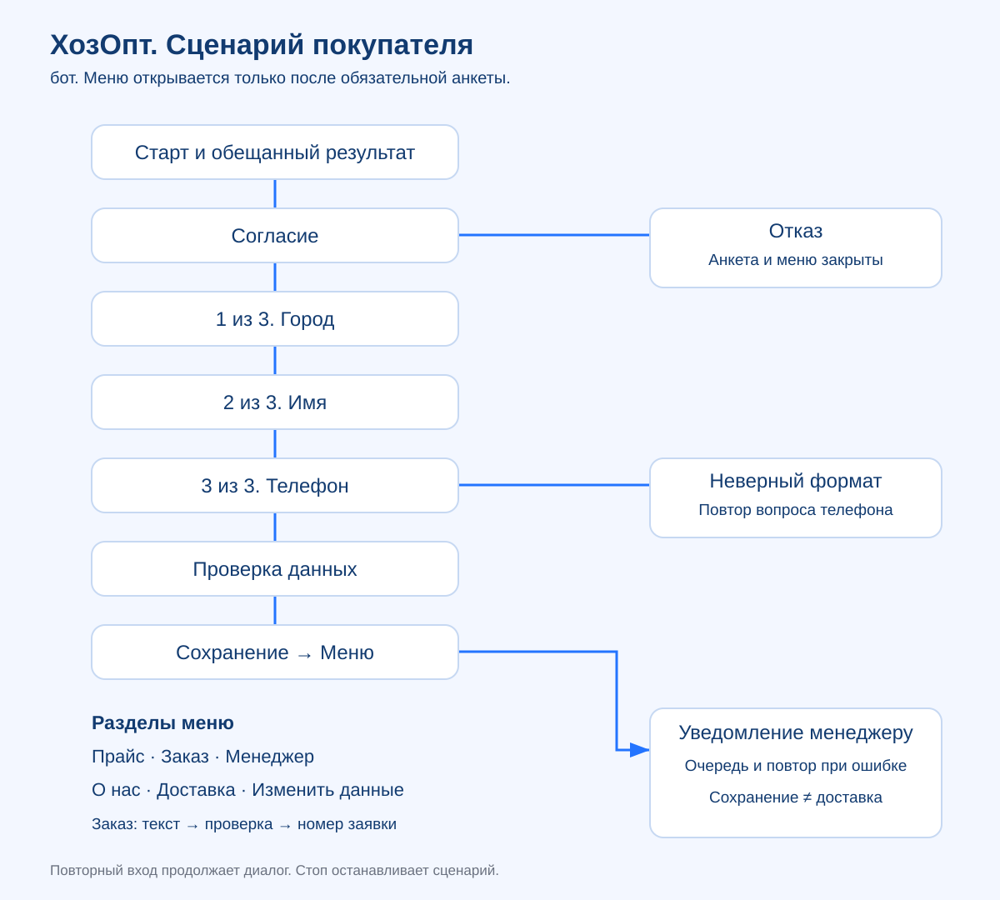
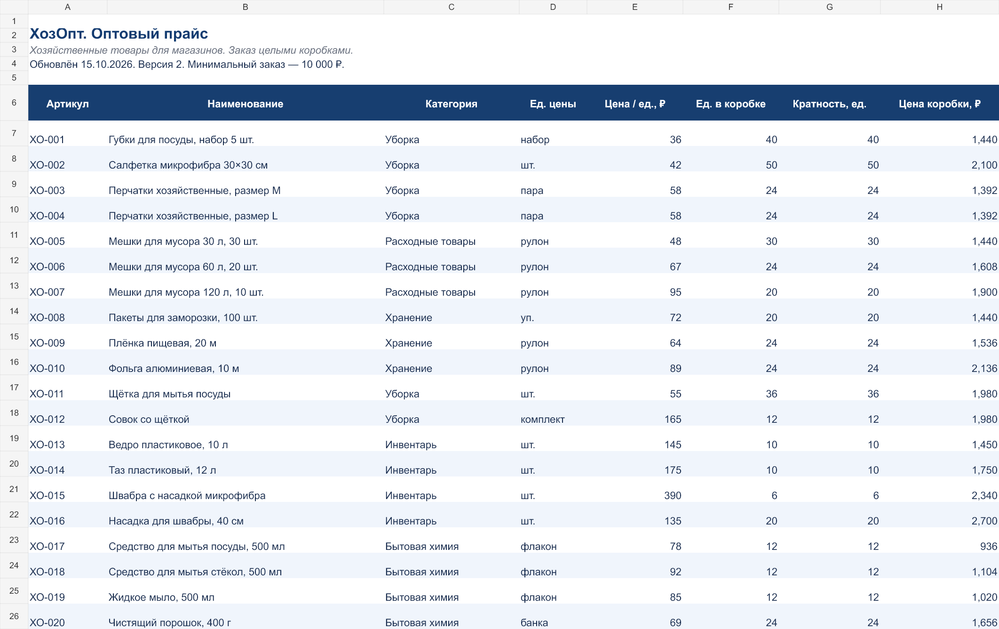
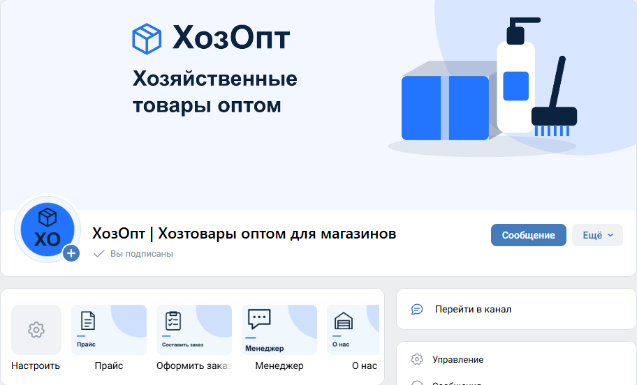
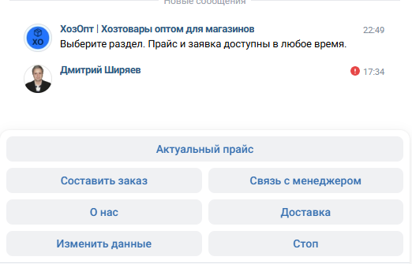

# ХозОпт — VK-бот для оптовых покупателей

Проект Дмитрия Ширяева: оформление сообщества,
анкета покупателя, выдача прайса, заявки и передача вопроса менеджеру.

[Сообщество ВКонтакте](https://vk.ru/hozopt_store) ·
[Автор](https://github.com/dmmshiryaev-bit)


## Задача

Помочь покупателю получить актуальный прайс и передать менеджеру оформленную заявку.
Условия поставщика, цены и ассортимент созданы для демонстрации; работа реального
оптового поставщика и коммерческие результаты не заявляются.

## Что реализовано

- Согласие перед анкетой; обязательные город, имя и телефон, проверка формата номера.
- Подтверждение и изменение данных; незавершённая анкета продолжается после перезапуска.
- Меню: прайс, заказ, менеджер, информация о компании и доставке.
- Ссылка на прайс из 20 позиций с ценой за единицу и коробку и кратностью упаковки.
- Подтверждение заявки, её номер, уведомление назначенному менеджеру.
- Передача разговора человеку и возвращение к автоматическому сценарию.
- SQLite: состояния, согласия, заявки, обработанные события и очередь исходящих сообщений.
- Защита от повторной обработки событий; повтор отправки с постоянным random_id.
- Три визуальных направления были подготовлены локально; в проект выбран синий комплект.



## Технологии

Python 3.12+, стандартная библиотека, SQLite, VK API 5.199.
Основной транспорт — messages.getLongPollServer + messages.getLongPollHistory.
Внешние Python-пакеты и языковая модель для этого сценарного бота не требуются.

## Проверить без доступа к VK

```bash
python -X utf8 -m unittest discover -s tests -v
python -X utf8 bot.py --simulate
```

Пример пути: `Начать` → `Согласен` → город → имя → вымышленный телефон → `Всё верно`.
Затем запросите прайс, оформите тестовую заявку или задайте вопрос менеджеру.
`/quit` завершает тренажёр. Симуляция работает в памяти, не обращается к сети
и не отправляет сообщения настоящим покупателям или менеджеру.

## Подключить своё сообщество

1. Скопируйте `config.example.json` в `config.json`.
2. Укажите ключ своего сообщества, его `group_id` и список `manager_ids`.
3. Замените ссылку прайса, сведения о компании, правила доставки и согласие.
4. Включите сообщения сообщества. Проверьте права ключа и разрешение менеджера
   получать сообщения от сообщества.
5. Выполните `python -X utf8 bot.py --check`, затем `python -X utf8 bot.py`.

Ключ хранится только в локальном `config.json`; рабочая конфигурация исключена из Git.
В примере нет ключа и личных ID администратора. Для запуска заполните свои значения.
Остановка — Ctrl+C. Не запускайте две копии на одной рабочей базе.

## Обслуживание

```bash
python -X utf8 tools/admin_tools.py queue
python -X utf8 tools/admin_tools.py retry
python -X utf8 tools/admin_tools.py backup
```

Команды показывают размер очереди, разрешают повтор ожидающих отправок и создают
резервную копию SQLite. Рабочие базы, логи, резервные копии и реальные контакты
в этот репозиторий не включены.

## Что проверено и какие ограничения

Локальные тесты проверяют анкеты, валидацию, заявки, передачу менеджеру,
очередь и обработку истории сообщений. В сохранённых материалах проекта от
15.10.2026 также зафиксированы живые проверки старта, анкеты, запрета обхода,
продолжения после перезапуска, заявки, уведомления менеджеру и возврата к боту.
Это историческая проверка; доступность работающего процесса сейчас отдельно не гарантируется.

Бот запускался на локальном Windows-компьютере. Постоянный сервер и автоперезапуск
не входят в опубликованную поставку. Заявка составляется свободным текстом:
остатки, кратность, минимальную сумму и итог подтверждает менеджер. Автоматическая
корзина, оплата, SMS-проверка телефона и рассылка не реализованы.
При потере истории Long Poll возможно отсутствие старых входящих событий.
Перед сбором реальных контактов владелец должен утвердить документы и правила
хранения/удаления данных; автоматическое удаление по сроку не реализовано.

## Материалы и структура

```text
bot.py                  сценарии, транспорт VK, хранение и очередь
config.example.json     шаблон настроек без ключа и личных ID
tests/test_bot.py       локальные тесты
tools/admin_tools.py    очередь, повтор, резервная копия
docs/scenario.md        сценарий и ветвления
materials/              демонстрационный прайс, каталог и схема
visuals/                выбранный синий комплект PNG и SVG
```

[Открыть демонстрационный прайс](materials/ХозОпт-прайс.xlsx)



## Автор

Дмитрий Ширяев — сайты, калькуляторы, чат-боты и цифровые материалы.
[Сайт](https://dmitry-shiryaev.vercel.app/) ·
[Почта](mailto:Dimitryi7510@yandex.ru)

## Скриншоты работающего интерфейса

Сохранённые снимки проверки от 15.10.2026. Кадры обрезаны по интерфейсу проекта: личная навигация и контактные данные не публикуются.

### Сообщество и навигация


### Возврат к боту и меню


Повторная локальная проверка 20.10.2026: все 24 теста пройдены. Доступ к живому VK API для тестов не использовался.
