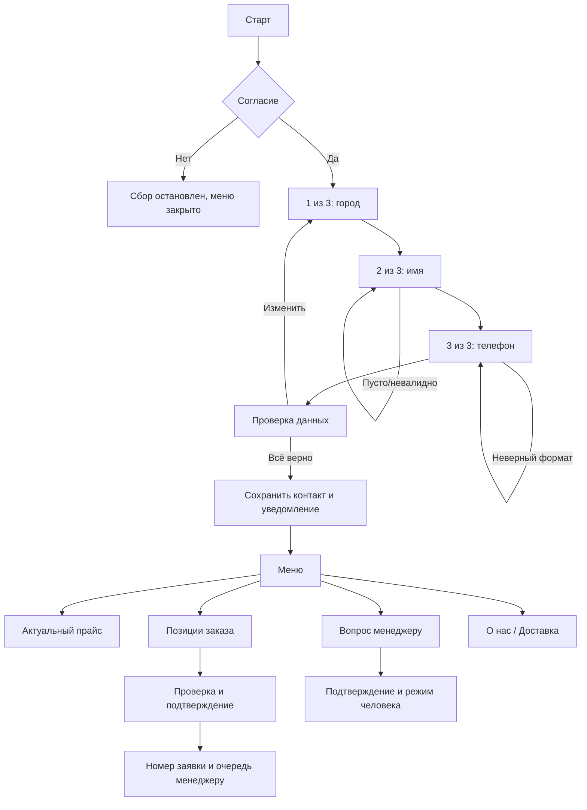

# Сценарий

В версии телефон российский, пробелы/скобки/дефисы разрешены. Без валидного телефона, имени, города и записи согласия меню закрыто. Ввод «Меню» вместо поля не даёт обхода. Пустой `text` вложения также проходит обязательную валидацию.

Повторный вход: готовому покупателю меню, незавершённой анкете продолжение сохранённого шага. «Стоп» останавливает сценарий, «Начать» возобновляет. «Отменить» отменяет черновик заявки. Перед отправкой есть подтверждение. При передаче человеку автоответы не мешают разговору, дополнения направляются менеджеру. Удаление данных — отдельное обращение администратору.

Прайс — ссылка, а не вложенный файл; бот не кэширует документ. Дата отображения берётся из конфигурации. Фактическая новая версия по той же публичной ссылке проверяется отдельно на Яндекс Диске.

Ежедневная рассылка не включена. Никакие отложенные сообщения по молчанию не отправляются.
